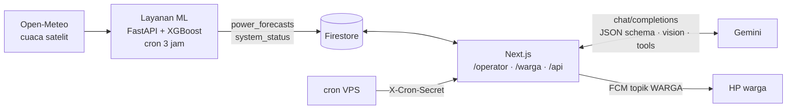

# ListrikSiberut · IslandGrid AI

[](https://github.com/rapipn02/siberut/actions/workflows/ci.yml)

Platform **Community Demand-Side Management** untuk microgrid terisolasi Pulau Siberut,
Mentawai (PLTS 75 kWp + PLTD 50 kW, 327 KK). AI memprediksi kapan listrik surya melimpah,
warga menggeser pemakaian alat berat ke **Jam Emas**, solar PLTD dihemat — setiap aksi
diverifikasi **Mata AI** dan dihargai poin BUMDes.

Satu aplikasi web, dua pintu (`/` langsung ke `/login`):

| Rute | Untuk | Isi |
|---|---|---|
| `/warga` | warga (HP, bisa di-install sebagai PWA) | Jam Emas, kirim bukti foto, poin & hadiah, Alat Saya, asisten |
| `/operator` | Admin BUMDes & Teknisi PLTD | pemantauan grid, Analis AI, Dampak Iklim (hari/minggu/bulan), verifikasi, broadcast, hadiah |

Next.js 16 · React 19 · Firebase (Auth + Firestore + FCM) · Tailwind 4 · Recharts · Gemini (endpoint kompatibel-OpenAI)

---

## Arsitektur



Firestore adalah penghubung antar tim (ML ↔ web). Semua tulisan yang menyangkut poin,
voucher, dan keputusan verifikasi terjadi di server (Admin SDK, transaksi) — klien hanya
membaca, kecuali membuat pengajuan foto dan daftar alat miliknya sendiri.

## AI di IslandGrid

| Fitur | Model | Di mana | Apa yang dikerjakan AI | Yang **tidak** diserahkan ke AI |
|---|---|---|---|---|
| Prediksi PLTS | XGBoost (tim ML) | `power_forecasts` | prakiraan surya & beban 48 jam | — |
| **Mata AI** | Gemini Vision | `/api/verify-participation` | menilai foto bukti: alat apa, sedang dipakai, foto layar/gambar internet; perkiraan watt | aturan waktu/duplikat tetap gerbang pertama; AI ragu → **ditahan untuk operator**, tidak pernah menolak sendirian |
| **Analis AI** | Gemini, JSON terstruktur | kartu dashboard, `/api/ai/briefing` | narasi risiko per jam, saran jadwal PLTD, draf imbauan (dipakai auto-broadcast) | angka (puncak, jam defisit, liter solar) dihitung kode |
| **Pindai Label Alat** | Gemini Vision | `/warga/alat`, `/api/ai/label` | membaca jenis, merek, watt dari nameplate | jadwal & penghematan dihitung kode |
| **Asisten Data** | Gemini, function calling | tombol ✦ Tanya, `/api/asisten` | menjawab pertanyaan warga/operator | jawaban hanya dari hasil tool; uid & peran dari token server |

Prinsip yang dipegang semua fitur AI:

- **Selalu ada jalur tanpa AI.** Key kosong, kuota habis (429), timeout, atau JSON rusak → `src/lib/llm.ts` mengembalikan `null` dan fitur jatuh ke aturan biasa.
- **Keluaran AI divalidasi** (`json_schema` + type-guard) sebelum menyentuh data.
- **Hemat kuota:** Mata AI hanya untuk pengajuan yang lolos aturan (maks 5/jalan cron); briefing maks tiap 2 jam; label & asisten dibatasi per pengguna per hari (`ai_kuota`).
- **Hasil disimpan** (`aiAnalisis`, `ai_briefing/terbaru`) sehingga tetap tampil saat kuota habis dan bisa diaudit.
- **Dampak terukur:** estimasi watt dari Mata AI → `estimasiKwh` per partisipasi → kartu *Dampak Nyata* (kWh, liter solar, rupiah, CO₂).

## Menjalankan

```bash
npm install
cp .env.example .env.local     # isi nilainya, lihat tabel di bawah
npm run dev                    # http://localhost:3000
```

### `.env.local`

| Variabel | Keterangan |
|---|---|
| `NEXT_PUBLIC_FIREBASE_*` | Firebase Console → Project settings → Your apps |
| `GOOGLE_APPLICATION_CREDENTIALS` / `FIREBASE_SERVICE_ACCOUNT_JSON` | service account (Admin SDK) — **jangan commit** |
| `CRON_SECRET` | wajib di produksi; kosong = route cron hanya terbuka di mode dev |
| `ISLANDGRID_API_BASE_URL`, `ISLANDGRID_API_KEY` | layanan ML (opsional saat lokal) |
| `LLM_BASE_URL`, `LLM_API_KEY`, `LLM_MODEL`, `LLM_REASONING_EFFORT`, `LLM_MAKS_TOKEN`, `LLM_BATAS_DETIK` | Gemini via endpoint kompatibel-OpenAI. Kosong = semua fitur AI nonaktif, aplikasi tetap jalan |

### Data & akun demo

```bash
npm run seed:warga   # aman untuk DB yang sedang dipakai: hanya akun demo warga
npm run seed         # ⚠ DB baru saja — MENIMPA poin, katalog, voucher, sesi
```

| Akun | Peran | Akses |
|---|---|---|
| `admin@bumdes.id` | Admin BUMDes | seluruh `/operator` |
| `teknisi@bumdes.id` | Teknisi PLTD | tanpa Sesi, Verifikasi, Hadiah, Poin |
| `warga@siberut.id` | Warga | `/warga` |

Kata sandi semua akun demo: `password123`. Warga baru mendaftar sendiri di `/warga/daftar`.

### Pemeriksaan

```bash
npm test          # 166 unit test
npx tsc --noEmit
npm run lint      # 0 error, 0 warning
npm run build
```

Semua dijalankan otomatis oleh GitHub Actions (`.github/workflows/ci.yml`) di setiap push/PR.

## API

| Endpoint | Siapa | Fungsi |
|---|---|---|
| `POST /api/sessions/tick` | cron / operator | status sesi UPCOMING→ACTIVE→ENDED, peserta, kWh tergeser, `statistik/dampak` |
| `POST /api/verify-participation` | cron / admin | mesin aturan + Mata AI, poin otomatis |
| `POST /api/auto-broadcast` | cron | beban ≥ 90% PLTD / defisit ≤ 3 jam → FCM + sesi otomatis (draf Analis AI bila segar) |
| `POST /api/forecast/refresh` | cron / operator | jalankan model ML, lalu perbarui briefing |
| `POST /api/ai/briefing` | cron / operator | susun briefing Analis AI |
| `POST /api/statistik/hitung` | cron / operator | hitung `statistik_harian` (hari ini + kemarin; operator boleh isi riwayat ≤ 120 hari) |
| `POST /api/broadcast` | operator | push imbauan manual |
| `POST /api/verifikasi/putuskan` | admin | setujui/tolak manual (transaksi, poin tidak ganda, saldo tak minus) |
| `POST /api/redeem` | warga | tukar poin → kode voucher (transaksi) |
| `GET /api/stok-hadiah` | publik | jumlah stok per hadiah — **tanpa kode** |
| `POST /api/ai/label` | warga | baca label alat |
| `POST /api/asisten` | warga / operator | asisten berbasis data |

"cron" = header `X-Cron-Secret`; "operator/admin/warga" = `Authorization: Bearer <Firebase ID token>`
yang diverifikasi server lalu dicocokkan dengan `operators/{uid}` atau `users/{uid}`.

## Keamanan

- Tidak ada header yang bisa dipalsukan dari browser; peran selalu dari token + Firestore.
- `firestore.rules`: warga **tidak bisa** membaca `voucher_stock` (berisi kode asli), menulis poin, atau membuat riwayat penukaran; `participation_requests.timestamp` wajib waktu server; `users.role` wajib `WARGA`.
- Mesin verifikasi membandingkan `timestamp` klien dengan `createTime` dokumen (waktu server) — klaim waktu mundur ditolak walau rules belum dipasang.
- Pasang `firestore.rules` dan `firestore.indexes.json` di Firebase Console (lihat `DEPLOY.md`).

## Batasan yang diakui

- Belum ada telemetri meteran: beban yang digeser adalah **perkiraan** dari daya alat di foto (asumsi 1 jam pemakaian), bukan pembacaan meteran.
- Prakiraan beresolusi per jam, diperbarui tiap 3 jam.
- Notifikasi portal warga hanya saat halaman terbuka (Web Push belum dibuat); FCM tetap untuk perangkat yang subscribe topik `WARGA`.
- Kuota gratis Gemini terbatas — fitur AI berhenti sementara saat habis, aplikasi tetap berjalan.

## Struktur

```
src/app/            page.tsx (alih ke /login) · operator/* · warga/* · login · api/*
src/lib/            logika murni + teruji (verification, mataAi, analisAi, alatWarga, asisten, warga, fuel, waktu, izin, llm)
src/lib/*Server.ts  bagian yang menyentuh Admin SDK (auth, briefing, asisten, kuota)
src/hooks/          listener Firestore (onSnapshot)
src/components/     UI bersama (PanelAsisten, KartuAnalisAi, KartuDampak, PanelAi, …)
```
